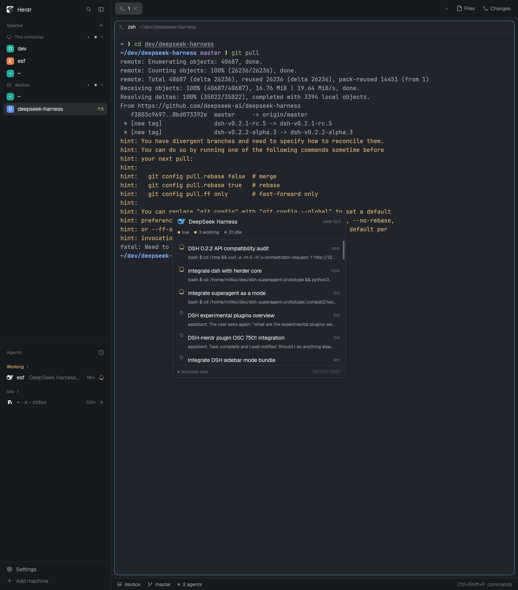
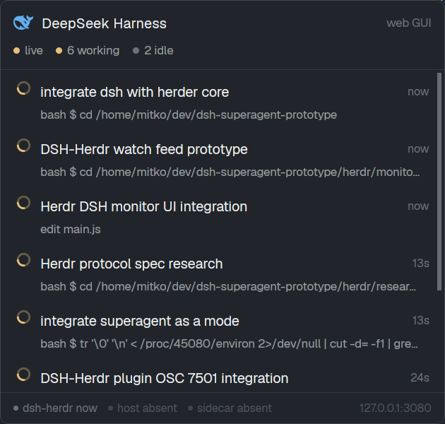

# dsh-herdr

[](https://github.com/mitkox/dsh-herdr/actions/workflows/ci.yml)
[](LICENSE)

See a **DeepSeek Harness** (`dsh`) agent inside **[Herdr](https://herdr.dev)** — and monitor it work.

Herdr's agent sidebar, "needs you" state and notifications, plus a live panel of
every dsh session, for a dsh host that keeps running where it is: **no dsh
restart, no HTTP token, read-only**.



## Why this exists

Herdr models an *agent* as a terminal whose program reports its state through the
open **OSC 7501** terminal protocol; in return it gives you an agent list,
`working` / `done` / **needs-you** badges, jump-to-agent and notifications.

dsh 0.2.x has no terminal front end: its agents live inside the `dsh web` host
and are driven from the browser. To Herdr, that host is just a `node` process —
no state, no row, no alerts.

What dsh *does* write is an append-only journal per session:

```
~/.dsh/sessions/<cwd-slug>/<session>/session.v4.jsonl.zstd
```

`dsh-herdr` tails those journals (read-only), aggregates their state, and reports
it to herdr-core with OSC 7501. Herdr then treats the pane your dsh host already
runs in as a **"DeepSeek Harness" agent**.

```
~/.dsh/sessions/**/session.v4.jsonl.zstd      (dsh host appends live)
            │
            ▼
      dsh-herdr  ── OSC 7501: state, app=dsh-tui, base64 title/msg ──►  herdr-core
            │                                                              │
            │  state JSON (~/.local/state/dsh-herdr/agents.json)           ▼
            └──────────────────────────────────────────────────►  herdr-app
                                                                  · agent row + icon
                                                                  · needs-you / done
                                                                  · dsh-monitor panel
```

## What you get

- **A real Herdr agent row** for the pane running `dsh web`: name, DeepSeek
  icon, live `working` / idle → `done`, the active session as the title and the
  current activity as the status message. A pending approval or user question
  makes it **blocked** ("needs you").
- **`dsh-monitor` panel** in Herdr: every session, status glyph, title, current
  activity, age and counts, with a link to the web GUI.
- **A launch entry** in Herdr's agent menu ("DeepSeek Harness (monitor)") that
  opens a monitored pane.
- **A live activity feed** you can put in a pane (`dsh-herdr watch`): turns,
  tool calls (`bash $ …`, `edit …`), titles, turns ending.
- **An optional native DSH host plugin** (`plugin/`): the same report written
  from inside the dsh host process — no pty shim, survives host restarts.
  Activating it is the only step that needs a dsh restart.



## Requirements

| Component | Version | Notes |
|---|---|---|
| [Herdr](https://herdr.dev) app + herdr-core | ≥ app 0.1.x / `hc` 0.1.17 | `hc` on `PATH`; app home at `~/.config/herdr-app` (or `HERDR_APP_HOME`) |
| DeepSeek Harness (`dsh`) | 0.2.x | journal format `session.v4.jsonl.zstd` |
| Node.js | ≥ 22.15 | uses `node:zlib` zstd (no `zstd` binary needed) |
| OS | Linux, macOS | Windows untested; attach mode on macOS is expected but unverified |

See [docs/COMPATIBILITY.md](docs/COMPATIBILITY.md) for the tested matrix and known caveats.

## Install

```sh
git clone https://github.com/mitkox/dsh-herdr
cd dsh-herdr
./install.sh --start        # files + launch the reporter daemon now
```

> **npm:** the unscoped `dsh-herdr` name on npm belongs to an unrelated
> package, so this project is not published there. If it is published later it
> will use a scope (`@mitkox/dsh-herdr`), installed as
> `npm install -g @mitkox/dsh-herdr && dsh-herdr install --start`. Until then,
> use the git checkout above — the installer is a single shell script.

The installer is additive and reversible: it installs
`~/.local/bin/dsh-herdr`, the panel mod under `~/.config/herdr-app/mods/`,
merges two entries into `~/.config/herdr-app/programs.json` (backing it up),
and starts `dsh-herdr daemon` so any `dsh web` pane is picked up and re-attached
when the host restarts.

Options: `--start` · `--systemd` (Linux; keeps reporting across
reboots) · `--plugin` (also install the native DSH host plugin into a new `herdr`
profile) · `--uninstall`.

Show the panel in Herdr:

```sh
herdr-app do mod.open --name dsh-monitor          # floating panel (Esc closes)
herdr-app do pane.split --direction right --mod dsh-monitor   # docked pane
```

Herdr's shipped `main` layout never auto-docks mods, so the overlay or a split is
the intended way; `herdr-app do layout.clone --name main --as dsh` if you want a
permanent layout.

## Use

```sh
dsh-herdr daemon                 # keep every dsh web pane reporting (installer starts it)
dsh-herdr attach                 # one pane: report into the dsh host's own Herdr pane
dsh-herdr watch                  # monitor pane: live feed for every session
dsh-herdr watch --session <id>   # follow one session
dsh-herdr watch --once --no-osc  # one-shot JSON summary (diagnostics)
dsh-herdr install | uninstall
```

The reporter follows a dsh host that restarts in the same pane, and re-attaches
when the host comes back. Reporting state is also written to
`~/.local/state/dsh-herdr/agents.json` (mode 0600), which the panel reads.

### Optional: native DSH host plugin (no pty shim)

```sh
plugin/install.sh                 # installs into a new dsh profile "herdr"
# then restart dsh in its Herdr pane once:  dsh --profile herdr --no-open
# verify:  hc get <pane>   ->  {"status":{"app":"dsh-tui","state":"idle"}}
```

Details, configuration and evidence: [plugin/README.md](plugin/README.md).

## How it works

- **Data source.** dsh appends every session event (`turn/start`, `tool/call`,
  `session/title`, `approval/asked`, …) to a zstd JSONL journal. The reporter
  decodes it tolerantly (the host may be mid-append) and folds turn state.
- **Status.** `working` while a top-level session is in a turn, `blocked` on a
  pending approval (journaled `approval/asked` without `approval/decided`) or a
  pending `ask_user_question` tool call, `idle` otherwise. Sub-agents are shown
  in the panel but do not take over the row.
- **Report.** OSC 7501 root record on the host pane's terminal:
  `state=…`, `app=dsh-tui` (so Herdr resolves "DeepSeek Harness" + icon),
  `title`/`msg` base64-encoded UTF-8, bounded to Herdr's limits.
- **Panel.** The `dsh-monitor` mod reads the state document (and optional extra
  paths via pane props) and renders it; it never controls or writes anything.

The wire-level details are documented, with evidence, in
[research/herdr-protocol.md](research/herdr-protocol.md). The reference
single-session / all-session sidecars live in [monitor/](monitor/README.md).

## Privacy and security

- **Read-only towards dsh.** The reporter reads local journals and writes
  terminal escapes; it never sends input, prompts a session or talks HTTP. It is
  not a network service.
- Journals and the state document contain **conversation titles, prompts and
  tool activity**. The state file is written mode 0600; treat it as private.
- The optional plugin runs inside your dsh host and only reports; it contains
  its failures and unsubscribes on dispose.
- See [SECURITY.md](SECURITY.md) for reporting and the threat model.

## Uninstall

```sh
./install.sh --uninstall          # on a git checkout
dsh-herdr uninstall               # via the npm-installed command
plugin/install.sh --profile herdr --uninstall   # only if you installed the plugin
```

## Documentation

| Document | Contents |
|---|---|
| [docs/COMPATIBILITY.md](docs/COMPATIBILITY.md) | tested versions, platform notes, known gaps |
| [docs/PUBLISHING.md](docs/PUBLISHING.md) | how to publish and list this project (maintainers) |
| [research/herdr-protocol.md](research/herdr-protocol.md) | OSC 7501 grammar/semantics, verified; probes + evidence |
| [monitor/](monitor/README.md) | reference journal sidecars, API notes, tests |
| [app/README.md](app/README.md) | the Herdr panel mod and program entries |
| [plugin/](plugin/README.md) | the native DSH host plugin, schema, evidence |
| [CONTRIBUTING.md](CONTRIBUTING.md) | development, tests, PRs |

## License

[Apache-2.0](LICENSE). The DeepSeek program icon comes from
[herdr-app](https://github.com/herdrdev/herdr-app) (Apache-2.0); see [NOTICE](NOTICE).
DeepSeek Harness itself is MIT-licensed and is not redistributed here.
